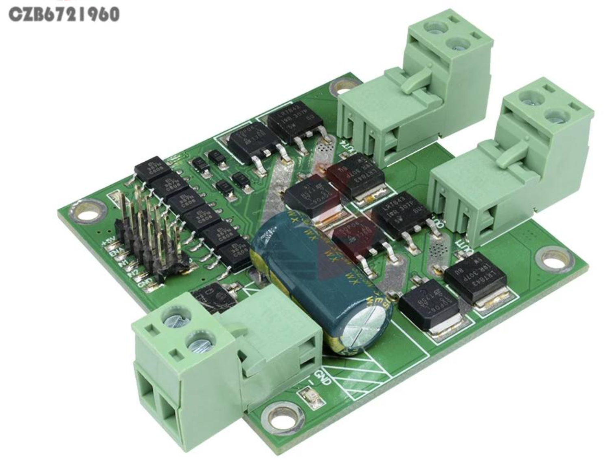

# L298 1207 MOTOR CONTROLLER BOARD

Dual-channel motor controller using L298 H-bridge logic control.

Available on [AliExpress](https://fr.aliexpress.com/item/32818921042.html).

The controller board has independent inputs for left and right motors.

There are three inputs for each channel, two binary inputs selecting direction and one PWM for speed.

We're using ENA, IN1 and IN2 for the left motor and ENB, IN3 and IN4 for the right motor.

## Connections

MOTOR A

| PIN | SIGNAL      |
|:---:|-------------|
| ENA | PWM control |
| IN1 | FWD         |
| IN2 | REV         |

MOTOR B

| PIN | SIGNAL      |
|:---:|-------------|
| ENB | PWM control |
| IN3 | FWD         |
| IN4 | REV         |

## Features

- Dual H-bridge
- Input voltage 7V - 24V DC, undervoltage protection
- Dual motor interface, each rated output current 7A
- Peak output current per channel: 50A
- L298 control logic
- Control signal voltage: 3 ~ 6.5V
- Control signal current: 3 ~ 11mA
- Optocoupler isolation for all control signals
- Undervoltage protection
- Electrostatic discharge circuit
- Minimum effective PWM pulse width: 5us
- Dimensions: 5.5 × 5.5 × 2.0cm

## Control signal logic

Motor control signal interface logic.

Put simply, `IN1/IN3` & `IN2/IN4` control the direction, '10' means forward, '01' means reverse, '00' is stop.

`ENA/ENB` controls the speed with a PWM signal, although full on means full speed.

| IN1 | IN2 | ENA | OUT1, OUT2 output |
|:---:|:---:|:---:|:------------------|
|  0  |  0  |  ×  | Braking           |
|  1  |  1  |  ×  | Vacant            |
|  1  |  0  | PWM | PWM Forward Speed |
|  0  |  1  | PWM | PWM Reverse Speed |
|  1  |  0  |  1  | Full Forward      |
|  0  |  1  |  1  | Full Reverse      |

| IN3 | IN4 | ENB | OUT3, OUT4 output |
|:---:|:---:|:---:|:------------------|
|  0  |  0  |  ×  | Braking           |
|  1  |  1  |  ×  | Vacant            |
|  1  |  0  | PWM | PWM Forward Speed |
|  0  |  1  | PWM | PWM Reverse Speed |
|  1  |  0  |  1  | Full Forward      |
|  0  |  1  |  1  | Full Reverse      |

Note: The input signals float high.

A typical example of  connection

## Notes

MCU power supply and driver board control signal power should be common ground, but not with the motor power supply GND.

Control signal optocoupler isolation, power spike voltage suppression.

H-bridge Method: Uses P, N complementary MOS transistors to achieve the H-bridge.

## Resources

- [How to Use L298 Dual H Bridge Motor Speed Controller: Examples, Pinouts, and Specs](https://docs.cirkitdesigner.com/component/f65e0424-b930-4dfe-a70d-dcc6ad3524d5/)l298-dual-h-bridge-motor-speed-controller
- [How to Use L298: Examples, Pinouts, and Specs](https://docs.cirkitdesigner.com/component/981a3f0b-bac9-4198-984d-bdcbdb413f5a/l298)
- [Interface L298N DC Motor Driver Module with Arduino](https://lastminuteengineers.com/l298n-dc-stepper-driver-arduino-tutorial/)
