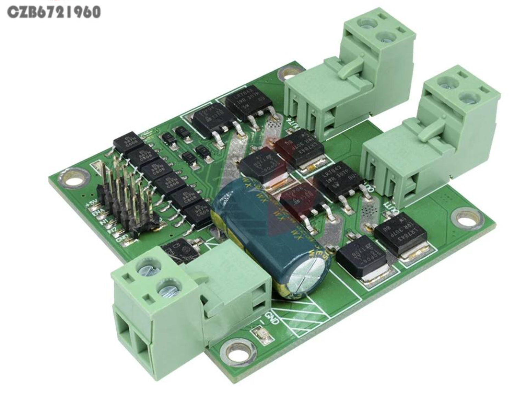

# PICO MOTOR CONTROL

This project is built around a commonly available dual-channel motor controller that uses the L298 dual H-bridge chip. For example, you can find it on [AliExpress](https://fr.aliexpress.com/item/32818921042.html).

For more information on this, see the [L298_Motor_Controller.md](Documentation/L298_Motor_Controller.md) file.

We're controlling this with a Raspberry Pi Pico 2W running MicroPython.

The project is also oriented somewhat to my Pico Motor Control board, but you don't need to use that. A Pico on a breadboard, stripboard or your own PCB would work just as well. The code does include elements relating to the digital and analogue sensor connections available on this board, but you can always strip out those bits or repurpose them for your own needs.

## INTERFACES

The Pico runs a WebSocket server on port 8080 over wifi which provides the main remote connection.

There is also a serial CLI over the USB connection which is useful for debugging, although not so much for actual operations.

## SENSORS

You don't need to have any sensors attached to use this code. But it does include code for two types of sensor:

- **Digital proximity sensors**: Both the board and the code assume sensors that produce a normally high signal at +5V (the board includes level shifting for compatibility with the Pico) and which switch low when the sensor comes within a predetermined distance from a sensor. This will generate an interrupt. What you do with that interrupt is up to you. As far as the board is concerned, the sensor has a 10k pullup on the digital output. The code & board provide for two of these sensors. I'm using the E18-D80NK.
- **Analogue sensors**: The board and code allow for three such sensors, about which they make certain assumptions: that the sensor requires +5V power and supplies an analogue signal that does not go above +3.3V. If you use a sensor that produces a higher output voltage, you'll need to step it down somehow. I'm using one of these sensors with a Sharp infrared rangefinder (the GP2Y0A21YK0F).

Information about the sensors I'm using is in the `Reference/Sensors/` folder. But, like I said, you don't have to use them. I've tried to indicate within the code which parts you can remove if not using sensors.

## OLED PANEL

This is another optional element. On the board, I've broken out the I2C0 port to run an SSD1306 OLED panel. You could use it for other sensors or devices - or nothing. The code sets up the I2C port and imports my basic SSD1306 library - but again, these are optional.
